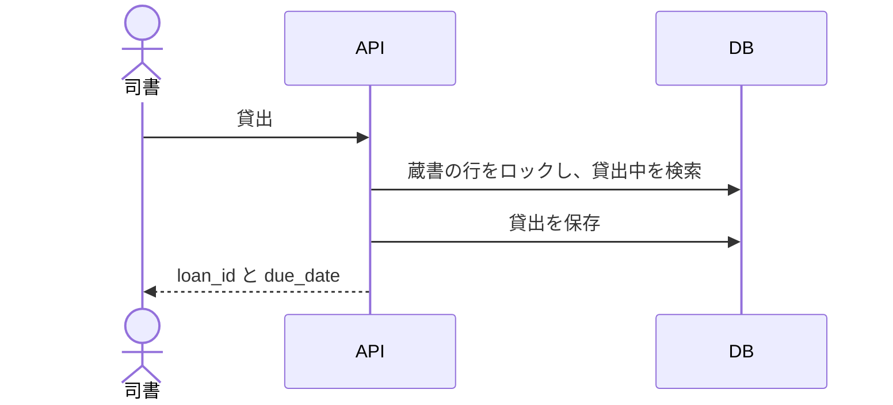
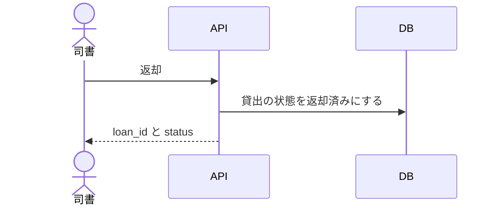
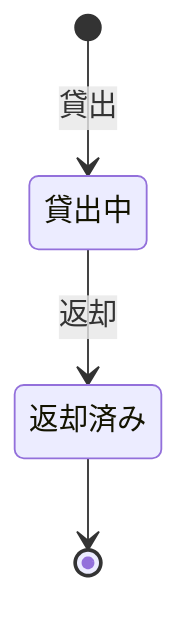

# 概要

本書は、地域図書館の貸出管理システムの設計を定義する。司書は、受付の端末で会員を登録し、蔵書の貸出と返却を記録する。会員は、返却期限までに蔵書を返す。

現行の課題は、貸出の記録が紙の台帳にあり、返却期限を過ぎた貸出を探すのに時間がかかることである。

# 要件

## 機能要件

- 会員登録において、司書は会員の氏名と連絡先を登録できる。
- 貸出において、司書は会員と蔵書を選び、貸出を記録できる。
- 返却において、司書は貸出を選び、返却を記録できる。

## 管理画面

貸出の一覧は管理画面で見る。この版では、管理画面は一覧の参照だけを持つ。

# 業務フロー

本節では、来館から返却までの流れを、画面、API、サーバーの責務に分けて定義する。

## 1. 会員の登録

司書は、初めて来館した人を会員として登録する。

### 1-1. 登録の受付

* **画面操作**: 司書は氏名と連絡先を入力して「登録」を押す。
* **サーバー処理**: サーバーは会員を保存し、会員番号を返す。連絡先が空のときは保存しない。

## 2. 貸出

司書は、会員が選んだ蔵書の貸出を記録する。1 冊につき 1 件の貸出を作る。

### 2-1. 貸出の確定

* **画面操作**: 司書は会員番号と蔵書を選び「貸出」を押す。
* **サーバー処理**: サーバーは単一のトランザクションで、蔵書の行をロックし、貸出中でなければ貸出を保存する。返却期限は貸出日の 14 日後とする。蔵書が貸出中なら `already_on_loan` を返し、保存しない。

## 3. 返却

司書は、返却された蔵書の貸出を完了にする。

### 3-1. 返却の記録

* **画面操作**: 司書は貸出を選び「返却」を押す。
* **サーバー処理**: サーバーは貸出の状態を返却済みにする。すでに返却済みなら、書き換えずに成功とする。

# 設計

## 開発機能一覧

会員登録、貸出、返却、貸出一覧。

## エラーハンドリング

API と DB の失敗は、サーバーがログを出して 4xx または 5xx を返す。画面は失敗を表示せず、押したボタンを再び押せるように戻す。

## API設計

本節は素案である。振る舞いの正は業務フローとデータベース設計である。

失敗時のボディは `{ "error": "<code>" }` とする。

| code | HTTP | 意味 |
| --- | --- | --- |
| `already_on_loan` | 409 | 蔵書がすでに貸出中である。貸出は保存しない |
| `invalid_input` | 400 | 値が不正で保存しない |

| API | メソッドとパス | 呼び元 |
| --- | --- | --- |
| 会員登録 | `POST /members` | 受付端末 |
| 貸出 | `POST /loans` | 受付端末 |
| 返却 | `PUT /loans/{loan_id}/return` | 受付端末 |
| 貸出一覧取得 | `GET /loans` | 管理画面 |

### 会員登録

| 項目 | 内容 |
| --- | --- |
| request | `name`、`contact`（空にできない） |
| response | `member_id` |

### 貸出

| 項目 | 内容 |
| --- | --- |
| request | `member_id`、`book_id` |
| response | `loan_id`、`due_date` |

### 返却

| 項目 | 内容 |
| --- | --- |
| request | パスの `loan_id` |
| response | `loan_id`、`status` |

### 貸出一覧取得

| 項目 | 内容 |
| --- | --- |
| request | クエリ `status`（省略時は貸出中） |
| response | 貸出の配列。貸出日の降順、同じ貸出日は `loan_id` の降順 |

## データベース設計

### 設計上の考慮点

* **主キー**: すべての主キーは `BIGINT` の連番とする。
* **外部キー**: 論理的な関係として使い、物理的には置かない。
* **貸出の重複防止**: 同じ蔵書の貸出中が 1 件になることは、一意制約ではなく、蔵書の行のロックで担保する。

### members（会員）

| 列 | 型 | NULL | キー | 内容 |
| --- | --- | --- | --- | --- |
| member_id | BIGINT | NO | PK | 会員番号 |
| name | VARCHAR(100) | NO | | 氏名 |
| contact | VARCHAR(200) | NO | | 連絡先 |

### books（蔵書）

| 列 | 型 | NULL | キー | 内容 |
| --- | --- | --- | --- | --- |
| book_id | BIGINT | NO | PK | 蔵書 |
| title | VARCHAR(200) | NO | | 書名 |

### loans（貸出）

| 列 | 型 | NULL | キー | 内容 |
| --- | --- | --- | --- | --- |
| loan_id | BIGINT | NO | PK | 貸出 |
| member_id | BIGINT | NO | INDEX | 会員。`members.member_id` |
| book_id | BIGINT | NO | INDEX | 蔵書。`books.book_id` |
| status | SMALLINT | NO | | `0` 貸出中、`1` 返却済み |
| due_date | DATE | NO | | 返却期限 |

## UML

### シーケンス

### ステートマシン

