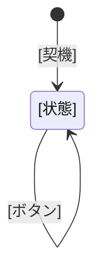

> これは人間が Design Doc を書くためのテンプレートです。節の役割と、各節に書く内容は [`designdoc.md`](designdoc.md) の見本に合わせています。
>
> 1. `[角括弧]` を対象システムの内容に置き換える。角括弧と、この案内は完成稿から削除する。
> 2. 完成稿は `designs/docs/` 直下に `*.md` として置く（ファイル名は自由。プロジェクトごとに複数置いてよい）。`domain-docs` を単独で起動したときに、PO が置いたファイルから1つを `AskQuestion` で選ぶ。自動検知はしない。この `designdoc.sample.md` を含む `*.sample.md` は選択候補から除外され、入力にならない。
> 3. 「複製する」と書いた見出しは、判断テーマ、業務、画面、API、テーブル、状態の数だけ増やす。見本のカフェ固有の名前は、対象システムの言葉に変える。
> 4. 図は実在するファイルだけを参照する。見本では利用者画面を `../images/enduser-ui/`、管理画面を `../images/manager-ui/`、ER 図を `../schemas/` に置いている。
> 5. 画面設計、画像、ER 図は Design Doc に書く。sequence と state の Mermaid 図は Domain docs（`docs/workflows.md`）へ引き継がれる。画像リンクは転記されない。`docs/data-models.md` の ER 図は、画像ではなく「データベース設計」のテーブルの記述（`### 物理名（業務名）` 見出しと列の表、関係の説明）から起こす。

# 概要

本書が定義する対象を、1 段落で書く。誰が、どの場面で、何をするシステムかを続ける。

関係者の現状と、このシステムで減らしたい負担を書く。見本では、店主の課題と、新しく扱う商品や販売物をここで述べている。

最低限の機能は次のとおり。

- [画面名] において、[主体] は [できること] を行う。
- [画面名] において、[主体] は [確認できること] を確認できる。画面は「[操作名]」操作を備える。
- [画面名] において、本システムは [利用者へ示す結果] を表示する。

作らないものと、動作条件を書く。見本では、外部サービス連携を開発しないこと、参考にしてよい範囲、クラウド上のデータベースへアクセスしないこと、レビュアーのローカルマシンで動作することを書いている。

# 要件

## 機能要件

`[要件の出典名]` の要件は次のとおり。

- [画面名] において、[主体] は [できること] を行う。
- [画面名] において、[主体] は [確認できること] を確認できる。画面は「[操作名]」操作を備える。
- [完了画面名] において、本システムは [利用者へ示す識別子] を表示する。

概要の最低限機能と対応させ、要件原文の言い回しが概要と違う場合は、要件側の言葉を残す。

## 機能要件の詳細分析

曖昧な部分があるため、要件を掘り下げて定義する。要件の文章を逸脱しない範囲で、実運用を想定した設計を行う。

判断テーマは、要件から一意に決まらない点ごとに 1 つ作る。見本では、提供形態、端末の置き方、注文と商品提供、会計に分けている。見出しは対象システムの言葉に変えて複製する。

### [判断テーマ]

この節で何を決めるかを 1 文で書く。根拠にする要件の文を引用し、その文の範囲で決めると書く。

#### 決定事項

- 要件に明記があるか、無い場合は文章から何と読み取るかを書く。
- 採用する方式を、選択肢が分かる粒度で書く。
- システムが扱わない処理と、人がシステム外で行う処理を分ける。

#### 決定理由

- 要件のどの文から、その方式が読み取れるかを書く。
- 採用しなかった方式が、なぜ対象の利用形態に合わないかを書く。

## 管理画面

要件に記載が無いか、あるかを最初に書く。運用に必要なため定義する場合は、本件で提供する範囲が最低限であることを書く。

### 決定事項

- 誰が操作し、誰が操作しないかを書く。
- 画面の構成を書く。見本ではタブ名、選択中の見た目、詳細の重なり方を書いている。
- 各画面が、どの業務の、どの操作を担うかを 1 項目ずつ書く。

### 決定理由

- 要件に記載が無くても定義する理由を、現場で何ができなくなるかで書く。
- 定義しない場合に残る運用と、実装するコストを書く。
- 要件がアレンジを許している場合は、その文を引用し、逸脱に当たらない判断を書く。

### その他

- 本件では扱わず、発展案に残す検討を書く。見本では、端末コストが大きくなった場合のモバイルオーダーをここに置いている。

# 背景

## 現行の課題

本システムが解決する課題は次のとおり。

- [誰が、どの作業に負担を感じているか]。
- [利用者が前提にできない知識や、伝えなければならない違い]。
- [既存のやり方では対応しきれなくなった変化]。

## 解決方針

- [課題に対して、システムが引き受けること]。
- [紙や口頭では表現できないことを、どの手段で伝えるか]。
- [増える対象を、どの単位で一元管理するか]。

# ユーザーストーリー

主体ごとに見出しを複製する。見本では来店客とスタッフに分け、来店から退店までの時系列で書いている。各項目は 1 操作、または 1 つの認識にする。

## [主体]

- [状況] のとき、[何を使って] [何をする]。
- [完了したとき] に、[何が分かり、何を覚えておくか]。
- [次の担当者] が [何を手がかりに] [何を渡す、または受け取る]。
- [終了条件] を満たしたら、[どの状態に戻すか]。

# 業務フロー

本節では、[開始] から [終了] までの業務の流れを、画面、API、サーバーの責務に分けて定義する。データの物理的なテーブル、カラム、ステータス値との対応は、後続の「データベース設計」を正とする。

業務のまとまりごとに `##` を複製する。見本は、端末の設置、注文、商品の受け渡し、会計の 4 つである。各まとまりの中の手順は `###` とし、見本の次のラベルから、その手順に必要なものだけを使う。

- **画面操作**: 誰が、どの画面で、何を見る、または何をタップするか。
- **API要求**: どの端末が、どの API を、どの引数で呼ぶか。API 名は `【名前】` で揃える。
- **サーバー処理**: 何を確認し、何を保存し、失敗時に何を返すか。トランザクション、ロック、一意にしない理由があればここに書く。
- **画面遷移**: 成功、既存データの再利用、入力の無効、それぞれで次にどの画面へ進むか。
- **外部操作**: 本システム外で人が行う作業。見本では POS への手打ちと外部端末の決済が該当する。
- **例外**: 通常の更新と違う操作。見本では口頭のキャンセルと、完了済みからの戻しを書いている。
- **画面リセット**: 状態が変わったあと、各端末がどの画面へ戻り、何を維持するか。

## 1. [業務のまとまり]

[このまとまりの前提を 1 文で書く。見本では、端末をどこに何台置くかをここで再確認している。]

### 1-1. [手順]

* **画面操作**: [契機と、呼ぶ API、分岐の根拠]。
* **サーバー処理**: [返す事実。ステータス値を出す場合は、データベース設計の値と一致させる]。
* **画面遷移**: [条件ごとの画面。条件は番号を付けて並べる]。

### 1-2. [手順]

* **画面操作**: [開いたときと、人が確定したときの操作]。
* **API要求**: [選んだ情報を添えて呼ぶ API]。
* **サーバー処理**: [追加、削除、既存行の扱い。制約で表さない制御は、その理由を書く]。
* **画面遷移**: [保存先と、次の画面]。

## 2. [業務のまとまり]

### 2-1. [手順]

* **画面操作**: [この画面を出してよい条件]。
* **API要求**: [呼ぶ API と引数]。
* **サーバー処理**: [ロックとトランザクションの範囲。新規に作る場合と、既存を使う場合]。
* **画面遷移**: [各結果の画面。同じ状態のあいだ行き来できる画面があれば書く]。

# 設計

## 開発機能一覧

作る機能を、分類、種別、機能の 3 列で書く。見本の分類はサーバー、フロントエンド、管理画面で、種別は API と画面である。1 行を 1 機能にし、業務フローの API と画面から漏れる行、増える行が無いように揃える。

| 分類 | 種別 | 機能 |
| --- | --- | --- |
| [サーバー / フロントエンド / 管理画面] | [API / 画面] | [機能を、入力と結果が分かる文で書く] |

## 開発機能対象外一覧

要件にあるもの、本件では過剰なものを分けて書く。見本では、外部システム連携、マスタ登録、ログ分析を対象外にしている。

| 機能 | 内容 |
| --- | --- |
| [機能] | [作らない理由。要件の明記か、本件の目的から外れる理由かを書く] |

## エラーハンドリング

API の失敗と DB の失敗を、サーバーがどう返し、画面が何を表示するかを書く。見本では、正常系を通すことが目的で、失敗の画面は作らない。値が不正なときは 4xx、保存そのものが失敗したときは 5xx としている。

失敗した応答のあと、画面を先へ進めるか、ボタンを戻すか、一覧の状態を変えるかを書く。

この節の対象外にする失敗と、そのときの画面の動きを書く。見本では、通常の分岐として扱うキーの無効と、競合で更新しない場合を対象外にしている。

## 画面設計

[利用者の画面] と [担当者の画面] は画面を分離する、のように、画面群の境界を 1 文で書く。

### 画面の同期

どの画面を、どの契機で取り直すかを書く。見本では、表示中は一定時間ごと、画面を開いたとき、操作したとき、更新が成功した直後にも同じ API を呼ぶ。サーバーから画面へ押し出さないことと、使わない方式も書く。

ポーリングしないデータと、その理由を書く。見本では、商品一覧、注文確認の金額、確定後の明細、セットアップの一覧を分けている。

| 画面 | API | 見るデータ | 結果 |
| --- | --- | --- | --- |
| [画面] | 【[API名]】 | [応答のどの値を見るか] | [値ごとの遷移、または一覧の置き換え] |

### ユーザー画面

この画面群の利用者を書く。見本では、最初の設定はスタッフ、開始以降は来店客としている。

画面ごとに見出しを複製する。見本の利用者画面は、セットアップ、開始、注文、注文確認、注文完了である。各画面は画像と、目的、表示、操作、遷移の 4 行で書く。

#### [画面名]


| 項目 | 内容 |
| --- | --- |
| 目的 | [この画面で達成すること] |
| 表示 | [見出し、並び、選択状態、金額や番号の見せ方] |
| 操作 | [押せる条件と、押せない条件。二重送信を防ぐ場合はその契機] |
| 遷移 | [成功、状態の不一致、識別子の無効、それぞれの次の画面] |

### 管理画面

利用者を書く。見本ではスタッフだけが操作する。

画面ごとに見出しを複製する。見本は、一覧タブ、詳細モーダル、関連状態の一覧に分け、列、ステータスの見た目、いまの状態と同じ操作を無効にすることを書いている。

#### [画面名]


| 項目 | 内容 |
| --- | --- |
| 目的 | [この画面で確認することと、記録すること] |
| 表示 | [列、1 行の意味、ステータスの文言と見た目、スクロール] |
| 操作 | [各ボタンを押す業務上の契機。現在の状態に当たるボタンの扱い。戻せる遷移と、戻せない遷移] |

## API設計

本節は素案である。振る舞いの正は業務フロー、画面設計、データベース設計である。パスと JSON の形は、その振る舞いを HTTP で運ぶための案である。

呼び出し元が同じ API を共有するか、認証を付けるかを書く。見本では、両端末が同じ API を呼び、認証は仕様に無いため素案では付けていない。

共通の形を書く。見本では、ボディは JSON、画面へ出す識別子は 10 進の文字列、端末キーは文字列のまま、日時の形式、金額の単位を定めている。例の ID や商品は、マスタの内容をその値に固定しないと書く。

失敗時のボディと、画面が分岐に使う code を表にする。code を付けない失敗は、エラーハンドリングに従うと書く。通常の画面分岐に使う結果は、このエラーにしない。

| code | HTTP | 意味 | 画面 |
| --- | --- | --- | --- |
| `[code]` | [HTTPステータス] | [保存するか、何が衝突しているか] | [どの画面が、何を表示し、何を変えないか] |

業務フローが名前を付けていない取得は、画面の表示に必要なものだけを足す。見出しに「画面から必要」と書く。取り直しの契機は、画面設計の画面の同期に従う。

| API | メソッドとパス | 呼び元 |
| --- | --- | --- |
| [API名] | `[METHOD] [path]` | [画面] |

API ごとに見出しを複製する。業務フローの番号と、呼ぶ契機を最初に書く。

### [API名]

[業務フローの該当手順。画面のどの操作で呼ぶか。]

| 項目 | 内容 |
| --- | --- |
| path | `[METHOD] [path]` |
| request | [フィールドと、無いときの値。リクエストが無い場合は「無し」] |
| response | [フィールドと、状態によって返さないフィールド] |

[分岐、ロック、コピーする値、採番、まとめる単位を文章で書く。失敗時の code と、画面がどこに留まるかを書く。]

`request`

```json
{
}
```

`response`

```json
{
}
```

状態で応答が変わる場合は、見本のように `response`（[状態]）として複数置く。

## データベース設計


### 設計上の考慮点

見本は、次の観点を箇条書きにしている。対象に無い観点は節を作らず、ある制約を置かない場合はその理由を書く。

* **主キーの採番**: [方式、型、自動採番を使わない理由]。
* **外部キー**: [論理関係と、物理制約を置かない理由]。
* **[関係]**: [中間テーブルの主キーと、一意にする側]。
* **[確定時にコピーする値]**: [どの時点の値をどの列へコピーし、マスタ変更の影響をどこで断つか]。
* **[採番する業務番号]**: [リセットの単位、開始値、重なりを防ぐトランザクション]。
* **検索用の二次索引**: [索引名、列、どの処理が使うか。索引では表さない制御を明示する]。
* **[同時更新の見送り]**: [厳密には行うべき制御と、本件で見送る理由。残す制御も書く]。

テーブルごとに見出しを複製する。見出しは `[物理名]（[業務上の名前]）` とする。表の前に、そのテーブルの主キー、業務上の対応、制約で表さない制御を文章で書く。

### [物理名]（[業務上の名前]）

[このテーブルが 1 行で表すもの。画面上の番号との対応。]

| 列 | 型 | NULL | キー | 内容 |
| --- | --- | --- | --- | --- |
| [列名] | [型] | [NO / YES] | [PK / UNIQUE / INDEX / 空] | [業務上の意味。他テーブルの対応列。索引に含む場合はその位置] |

### 画面との対応

画面の項目が、どのテーブルのどの列、またはどの行の集計かを書く。見本では、確定前と確定後で参照先を分け、数量は行数で表している。

| 画面の項目 | 参照 |
| --- | --- |
| [画面の項目] | [テーブル.列、または集計の定義] |

## UML

### シーケンス

業務フローの番号と対応させる。システム外の操作は、該当する図の中でシステム外と分かるように示す。見本では、POS への手打ちと外部端末の決済を会計の図に置いている。

業務フローのまとまりごとに見出しを複製する。参加者は、人と、画面、API、データベースに分ける。分岐は業務フローの条件と同じにする。

#### 1. [業務フローの見出し]

```mermaid
sequenceDiagram
  actor Actor as [人]
  participant UI as [画面]
  participant API as API
  participant DB as データベース

  Note over UI, API: [業務フローの手順番号と契機]
  Actor->>UI: [操作]
  UI->>API: 【[API名]】([引数])
  API->>DB: [確認または保存]
  API-->>UI: [返す事実]
  alt [条件]
    UI->>Actor: [画面]
  else [条件]
    UI->>Actor: [画面]
  end
```

トランザクションは、見本のように `rect` で範囲を囲み、ロックする行と、確認しない条件を Note に書く。

### ステートマシン

状態を持つ対象ごとに、文章、遷移表、図の順で複製する。見本では注文明細と伝票を分け、現在の状態と同じ操作を無効にすることと、作成前に必要なロックを文章で先に書いている。

`[テーブル.列]` は、[状態名を列挙] の [数] 値とする。[戻せない遷移] は無い、と書く。

| 遷移 | 契機 | 値 |
| --- | --- | --- |
| 初期 → [状態] | [保存の契機と、保存してよい条件] | `[値]` |
| [状態] → [状態] | [画面とボタン] | `[値]` |


